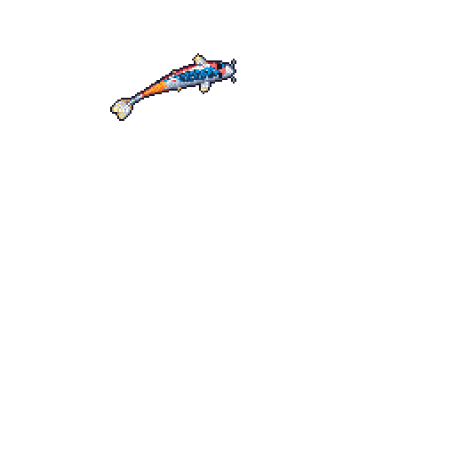

# MOUNSEF DEBACHE

**AI / Machine Learning Engineer** &nbsp;·&nbsp; **Python** &nbsp;·&nbsp; **MLOps**

---

### About

AI / ML engineer with a control engineering background. I build machine learning systems with an emphasis on reproducibility, clean Python, and deployment.

`France` &nbsp; `M2 Artificial Intelligence — Télécom SudParis / Paris-Saclay` &nbsp; `Control Engineering — École Polytechnique d'Alger`

**Focus:** Applied ML · Deep Learning · Generative AI · Agentic Systems · MLOps

**Open to:** AI Engineer · Machine Learning Engineer · Data Scientist

### Tech stack

**LLMs & Agents**

**ML & Deep Learning**

**Data & Production**

**Developer Tooling**

### Selected Projects

- **[Sephora Test](https://github.com/Mounsef27/sephora_test)** — NLP · ML Engineering
- **[Classifier-Guided Diffusion](https://github.com/Mounsef27/classifier_guidance_diffusion_model)** — Generative AI · Deep Learning
- **[Keysonic](https://github.com/Mounsef27/keysonic)** — Acoustic Signal Processing · Deep Learning
- **[PolyMAZE](https://github.com/Mounsef27/PolyMAZE)** — Robotics · Embedded Systems

[All repositories](https://github.com/Mounsef27?tab=repositories)

### Engineering Experience

**Applied ML / Recommendation Systems**

Customer propensity prediction, product ranking, temporal backtesting and experiment tracking.

`Python` `CatBoost` `XGBoost` `PySpark` `Databricks` `MLflow`

**LLM Systems**

Retrieval-augmented generation, local LLMs and agentic workflows.

`RAG` `LangChain` `LangGraph` `Ollama`

### Recognition

`3rd Place` Yassir AI Hackathon · Dec 2024

`3rd Place` SynapseON · Jul 2024

`IFA Excellence Scholarship` · 2025

### Contributions

<picture>
  <source
    media="(prefers-color-scheme: dark)"
    srcset="https://raw.githubusercontent.com/Mounsef27/Mounsef27/output/github-snake-dark.svg"
  />
  <source
    media="(prefers-color-scheme: light)"
    srcset="https://raw.githubusercontent.com/Mounsef27/Mounsef27/output/github-snake.svg"
  />
  
</picture>

---

  Build. Test. Deploy.

