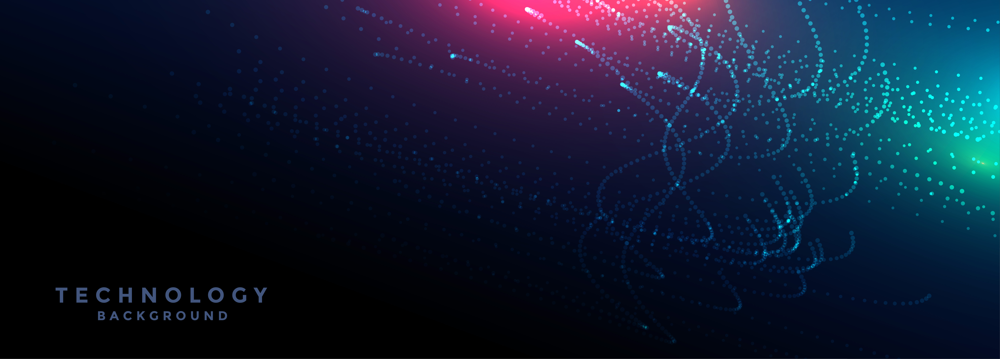

<h1 align="center">Hi, I'm DEBACHE MOUNSEF 👋</h1>

M2 AI @ Télécom SudParis • Robotics / Perception / Deep Learning

  <a href="mailto:debachemounsef@gmail.com">Email</a> •
  <a href="https://www.linkedin.com/in/mounsef-debache-500b10273/">LinkedIn</a> •

---

## 🚀 What I do
- 🤖 Autonomous systems: perception, localization, navigation
- 🧠 Deep Learning: CNN/RNN/LSTM, Transformers (if applicable), model evaluation
- 🛠️ Engineering: clean pipelines, experimentation, reproducibility

---

## 🏆 Highlights
- Winner — **PolyMAZE** autonomous maze-solving competition (ENP Algiers)
- Published a paper on **EMG-based fatigue detection** for human-robot collaboration  
  → [ResearchGate link](https://www.researchgate.net/publication/394946445_EMG-Based_Fatigue_Detection_System_for_Robotic_Collaboration_A_Deep_Learning_Approach)

---

## 📌 Featured Projects
- **EMG Fatigue Detection (Deep Learning)** — CNN/LSTM + augmentation, real-time HRC indicator  
  → Repo: `https://github.com/Mounsef27/EMG-classification-using-deep-learning`
- **Unstable System Identification** — MLP/RNN vs ARIMA/ARIMAX on dynamic systems  
- **Industrial Defect Detection** — CNN / MobileNet / YOLO for quality inspection  

---

## 🧰 Tech Stack (core)
**ML/DL:** PyTorch • scikit-learn • NumPy • Pandas  
**Robotics:** ROS2 • Gazebo • LiDAR  
**Languages:** Python • C/C++  
**Tools:** Git • Linux • MATLAB/Simulink

<b>Full tech stack (badges)</b>

### Languages

### ML / Data

### Robotics

### Tools

---

## 📫 Contact
- Email: debachemounsef@gmail.com
- LinkedIn: https://www.linkedin.com/in/mounsef-debache-500b10273/

  

